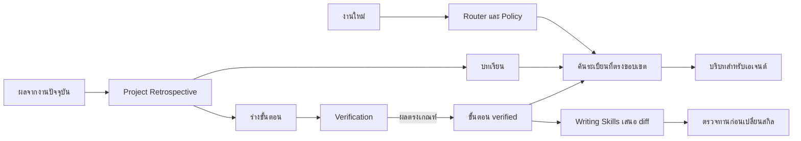

# NyxSkill Learning Loop — Full Design

สถานะ: มี CLI และสกิลรองรับแล้ว ดู LEARNING-LOOP.md สำหรับรูปแบบที่ใช้งานจริง
ขอบเขต: NyxSkill repository และโปรเจกต์ที่เลือกใช้ระบบเรียนรู้

ระบบเก็บบทเรียนจากความผิดพลาดตามแนว Reflexion และสะสมขั้นตอนที่ผ่านการตรวจตามแนว Voyager รุ่นแรกเก็บข้อมูลในโปรเจกต์และให้ผู้ใช้ตรวจ diff ก่อนนำบทเรียนไปเปลี่ยนสกิลที่ใช้งานร่วมกัน จุดวัดผลคือเอเจนต์ทำงานเดิมได้ดีขึ้นบนโจทย์ใหม่ที่มีเงื่อนไขใกล้เคียงกัน

## 1. โครงสร้างระบบ

| ส่วน | ความรับผิดชอบ |
| --- | --- |
| Project Retrospective | สรุปเหตุการณ์ ข้อสังเกต สมมติฐาน และสิ่งที่ควรลองต่อ |
| Learning store | ตรวจ schema และเก็บประวัติแต่ละระเบียนในโปรเจกต์ |
| Verification | ตรวจผลจริงและบันทึกขอบเขตหลักฐานที่ยืนยันได้ |
| Route enrichment | ค้นระเบียนประกอบหลัง Router เลือกสกิลและผ่าน policy แล้ว |
| Writing Skills | สร้างข้อเสนอเปลี่ยนสกิล พร้อมหลักฐานและกรณีทดสอบ |




## 2. การเปิดใช้และขอบเขตข้อมูล

ใช้ `--root` สำหรับ registry ตามปัจจุบันและเพิ่ม `--project` สำหรับโปรเจกต์ที่กำลังทำงาน เพื่อให้ CLI ที่รันจาก NyxSkill repo เข้าถึงบทเรียนของโปรเจกต์เป้าหมายได้ตรงที่ รุ่นแรกเปิดค้นผ่าน `route --learning --project PATH` เท่านั้น และใช้คำสั่งแยกสำหรับบันทึก การเปิดค้นและการบันทึกเป็นคนละการกระทำ

เก็บใน `<project>/.nyxskill/learning/v1/` โดยใช้ชื่อไฟล์จาก UUID ของระเบียน ตรวจ project root จริงและปฏิเสธ symlink หรือ junction ในเส้นทาง store ทั้งขณะอ่านและเขียน สำหรับโปรเจกต์ Git ที่ยังไม่ได้ ignore โฟลเดอร์นี้ ให้เตือนตอนเริ่มเก็บและแสดงวิธีตั้ง ignore เฉพาะโปรเจกต์ ชุด build และ pack ต้องกัน store นี้จากรายการบรรจุโดยตรง

## 3. สัญญาข้อมูล

| ส่วน | ฟิลด์และกฎ |
| --- | --- |
| ร่วมกัน | `schemaVersion: 1`, `id` เป็น UUID, `revision` เริ่มที่ 1, `kind`, `skillId`, `taskTags`, `createdAt`, `updatedAt`, `scope` |
| ขอบเขต | `platform`, `taskKind`, `targetKind`, `toolVersions`, `capabilities` และ `evidenceLevel` ที่ต้องการ ใช้ค่าที่ตรวจจากงานปัจจุบันในการเทียบ |
| บทเรียน | `observation`, `attempt`, `outcome`, `hypothesis?`, `nextCheck`, `sourceRef?`, `state: active` หรือ `retired` |
| ขั้นตอน | `title`, `preconditions`, `steps`, `expectedChecks`, `lessonIds`, `state: draft`, `verified` หรือ `retired`, `evidence[]` |
| หลักฐาน | `kind`, `runId`, `sourceFingerprint`, `procedureDigest`, `observedAt`, `checks[]`, `artifactRef?` และข้อมูลระบุสภาพแวดล้อมของ verifier |

`steps` เป็นข้อความสั้นหรือโครงสร้าง `{ executable, args }` เพื่ออธิบายขั้นตอน การเรียกเครื่องมือเกิดจากเอเจนต์ที่ตรวจขอบเขตและสิทธิ์ในงานปัจจุบัน `artifactRef` เป็นรหัสหรือเส้นทางสัมพัทธ์ในขอบเขตที่กำหนด เก็บผลสรุปกับ fingerprint เท่าที่ใช้ตัดสินได้ และตัดข้อมูลลับก่อนเขียนไฟล์

ตรวจชนิดข้อมูล ฟิลด์เกิน ขนาดข้อความ ความยาวรายการ และสถานะที่ยอมรับได้ กำหนดค่าเริ่มต้นสูงสุด 64 KiB ต่อระเบียน และ 500 ระเบียนปัจจุบันต่อโปรเจกต์ เมื่อเต็ม ให้แจ้งและให้ผู้ใช้เลือกถอนหรือจัดเก็บระเบียนเดิม ไฟล์รุ่นที่อ่านไม่รู้จักหรือไฟล์เสียถูกข้ามพร้อม diagnostics เฉพาะชื่อระเบียน การค้นยังเดินต่อได้

## 4. สถานะ การเขียน และการกู้คืน

- บทเรียนเริ่ม `active` และถอนเป็น `retired` เมื่อแก้ความเข้าใจหรือหมดประโยชน์
- ขั้นตอนเริ่ม `draft` ผ่าน verifier จึงเป็น `verified` การแก้ขั้นตอน เงื่อนไข หรือเกณฑ์ตรวจจะสร้าง revision ใหม่เป็น `draft` พร้อมเก็บหลักฐานของ revision เดิม
- การถอนใช้สร้าง revision `retired` ประวัติยังเปิดดูได้ Router เลือกจาก revision ล่าสุดของแต่ละ ID
- การยืนยันซ้ำด้วย `runId` และ digest เดิมให้ผลเดิมโดยไม่สร้างหลักฐานซ้ำ รายงานที่ใช้ run ID เดิมแต่เนื้อหาต่างกันให้หยุดตรวจและแสดง conflict

ใช้ไฟล์ revision ที่ไม่แก้ย้อนหลัง เช่น `<id>/<revision>.json` การเขียนถือ lock ระดับโปรเจกต์ผ่านการสร้าง lock directory แบบ exclusive ตรวจ `expectedRevision` ก่อนสร้าง revision ถัดไป เขียนไฟล์ชั่วคราวในไดเรกทอรีเดียวกันแล้ว rename เป็นชื่อจริงก่อนปล่อย lock ผู้อ่านอ่านเฉพาะไฟล์ที่เผยแพร่แล้ว การเขียนพร้อมกันของ revision เดียวกันจะมีเพียงครั้งเดียวที่สำเร็จ อีกครั้งจะเห็น busy หรือ conflict และต้องอ่านสถานะล่าสุดก่อนลองใหม่ หาก process ตายระหว่างเขียน ให้ตรวจ lock และไฟล์ชั่วคราวโดยใช้คำสั่งกู้คืนที่ผู้ใช้เรียกเองหลังตรวจว่าเจ้าของ lock หยุดแล้ว

## 5. การค้นและจัดอันดับ

1. ดึง `skillId` จาก `chain` ที่ผ่าน policy แล้ว และใช้แท็กจากงานที่ส่งให้ CLI หรือจาก intent ที่แมปเป็นแท็กแบบกำหนดไว้
2. กรอง scope ที่ขัดกับแพลตฟอร์ม ประเภทงาน รุ่นเครื่องมือ หรือ capability ที่ตรวจได้ ขั้นตอน `verified` ที่มีเงื่อนไขจำเป็นแต่ข้อมูลปัจจุบันยังขาด จะแสดงเหตุผล `needs-recheck` แยกจากคำแนะนำที่เลือกใช้
3. ขั้นตอนที่เลือกต้องมี `procedureDigest` ตรงกับ revision และมีระดับหลักฐานตรงตามงาน จัดลำดับตามจำนวนเงื่อนไขที่ตรงอย่างเจาะจง ตามด้วยจำนวนแท็กที่ตรง เวลา และ ID สำหรับตัดสินกรณีคะแนนเท่ากัน บทเรียนต้องมีแท็กตรงอย่างน้อยหนึ่งตัวและสกิลตรงกับ `chain`
4. คืนได้อย่างละหนึ่งรายการ พร้อมเหตุผลและรหัสระเบียน หากไม่มีรายการที่ตรง ผล routing หลักยังใช้งานได้

รุ่นแรกค้นแบบกำหนดกฎจาก metadata ภายในเครื่อง จึงอธิบายและทดสอบอันดับได้จาก fixture หากพบว่าการค้นพลาดคำพ้องจนกระทบงานจริง ค่อยประเมิน semantic search เทียบกับผลเดิม


| ระดับ | ใช้ยืนยัน |
| --- | --- |
| `host` | คำสั่งหรือชุดทดสอบบน host ที่ระบุชื่อและผลไว้ |
| `guest` | คำสั่งใน VM ตรงกับรายงานของรอบปัจจุบัน |
| `interactive` | ขั้นตอนที่มีหลักฐานการโต้ตอบ UI ตามผลที่งานต้องการ |

ระดับหลักฐานเป็นประเภทที่ต้องตรงกับข้ออ้าง เช่น guest test แบบ headless ใช้ยืนยันเฉพาะพฤติกรรมที่ตรวจใน guest หลักฐาน UI ใช้ยืนยันขั้นตอนที่สังเกตได้ และแต่ละประเภทใช้ร่วมกันได้เมื่อโจทย์ต้องการทั้งสองอย่าง


## 7. CLI และการยกระดับเป็นสกิล

คำสั่งที่เสนอ โดย `--project PATH` ระบุได้ทุกคำสั่ง

```text
nyxskill learn record --from RECORD.json --project PATH
nyxskill learn list --project PATH
nyxskill learn show ID --project PATH
nyxskill learn verify ID --evidence FILE --expected FILE --project PATH
nyxskill learn retire ID --reason TEXT --project PATH
nyxskill route REQUEST --learning --project PATH --json
nyxskill learn propose ID --project PATH
```

`record` สร้างบทเรียนหรือร่างขั้นตอนและคืน ID ผู้เรียกส่งหลักฐานผ่าน `verify` เพื่อให้ตัวตรวจเป็นผู้เปลี่ยนสถานะ `route` เพิ่มฟิลด์ `learning` เฉพาะเมื่อเปิดใช้ โดยมี `lesson`, `procedure`, `diagnostics` ตามที่พบ ผล `chain` และ `rejected` มาจาก Router เดิม `propose` ส่ง diff ให้ตรวจ โดยเสนอแก้สกิลที่เกี่ยวข้องก่อน และเสนอเพิ่มสกิลใหม่เมื่อไม่มีสกิลเดิมที่รับผิดชอบงานนั้น

เกณฑ์เริ่มต้นสำหรับเสนอ diff คือขั้นตอนผ่านอย่างน้อยสองรอบที่เป็นอิสระต่อกันและตรงขอบเขตที่จะเขียนในสกิล แนบ trigger ที่ควรใช้และกรณีที่ต้องข้าม พร้อมผลทดสอบเดิมและผลทดสอบหลังปรับ การย้อนข้อเสนอที่นำไปใช้แล้วทำผ่าน diff ย้อนกลับของสกิล ระเบียนต้นทางสามารถถอนใช้แยกได้

## 8. การทดสอบและการวัดผล

| กรณี | ผลที่คาดหวัง |
| --- | --- |
| เปิดหรือปิด learning บนคำขอเดียวกัน | `chain` และการตัดสิน policy เหมือนกัน บริบทเพิ่มเฉพาะโหมด learning |
| งาน installer เทียบกับงานเอกสาร | ขั้นตอน VM ปรากฏเฉพาะงานที่ scope ตรง |
| เวอร์ชันเครื่องมือเปลี่ยนหรือข้อมูลไม่ครบ | มีเหตุผลให้ตรวจซ้ำ และขั้นตอนไม่ถูกเลือกเป็นคำแนะนำที่ยืนยันแล้ว |
| host report, guest report เก่า หรือคำสั่งทดสอบขาด | ขั้นตอนไม่เลื่อนเป็น `verified` สำหรับข้ออ้าง guest รอบปัจจุบัน |
| เขียนพร้อมกัน process ตาย และไฟล์เสีย | revision ก่อนหน้ายังอ่านได้ การเขียนชนกันไม่ทับข้อมูล และ Router ยังทำงาน |
| ระเบียนพยายามสั่งข้ามสิทธิ์หรือชี้ไฟล์นอกโปรเจกต์ | ไม่มีการเรียกเครื่องมือหรืออ่านไฟล์นอกขอบเขตจากระเบียน |
| แพ็กซอร์สและ plugin | ไม่มีไฟล์ store หรือรายงานงานจริงในแพ็ก |

ประเมินกับโจทย์คู่ที่ไม่ใช้สร้างระเบียน โดยเทียบ NyxSkill ปัจจุบันกับโหมด learning ภายใต้โมเดล เครื่องมือ และจำนวนครั้งที่ลองเท่ากัน วัดอัตราสำเร็จจากเกณฑ์ของงาน จำนวนการลองผิดซ้ำ จำนวนรอบจนผ่าน สัดส่วนที่ดึงระเบียนไม่เกี่ยวข้อง และข้ออ้างผลเกินหลักฐาน รายงานจำนวนงานและตัวอย่างที่ระบบทำให้แย่ลงด้วย เกณฑ์ก่อนเปิดเป็นค่าปริยายคืออัตราสำเร็จไม่ลด จำนวนการลองซ้ำลดลง และชุดตรวจขอบเขตหลักฐานผ่านทั้งหมด

## 9. ลำดับพัฒนา

1. เพิ่ม schema, store และคำสั่งอ่าน/บันทึก พร้อมทดสอบไฟล์เก่า ไฟล์เสีย และการเขียนพร้อมกัน
2. ต่อ retrieval แบบ opt-in กับ `route` และทดสอบว่าการเลือกสกิลและ policy คงเดิม
4. เพิ่ม `propose` แบบแสดง diff และทดสอบกับโจทย์ที่กันไว้ก่อนตัดสินว่าจะเปิดใช้กว้างขึ้นหรือไม่

แนวคิดอ้างอิง: [Reflexion](https://arxiv.org/abs/2303.11366) และ [Voyager](https://voyager.minedojo.org/#voyager-components)

## 10. สร้างสกิลฉบับร่างด้วยเอเจนต์

Writing Skills เขียน `SKILL.md`, `skill.yaml` และ `DRAFT.md` ลงใน `.nyxskill/skill-drafts/` ได้เองก่อนส่งมอบงานในโปรเจกต์ NyxSkill หรืองานที่ผ่าน Router เมื่อเจอ workflow ที่ทำซ้ำได้และมีหลักฐาน และยังรองรับคำขอสร้างสกิลโดยตรง สกิลนี้ตรวจการซ้ำกับ registry ก่อนเขียนและตรวจร่างในขอบเขตแยก CLI เก็บระเบียน ตรวจหลักฐาน ค้นตาม scope และเสนอ diff ได้แล้ว เอเจนต์เรียกคำสั่งเหล่านี้ตามสกิลของงาน และใช้ workflow สร้างไฟล์ร่างเมื่อต้องส่งให้ตรวจทาน

## 11. รายละเอียดการนำไปใช้
